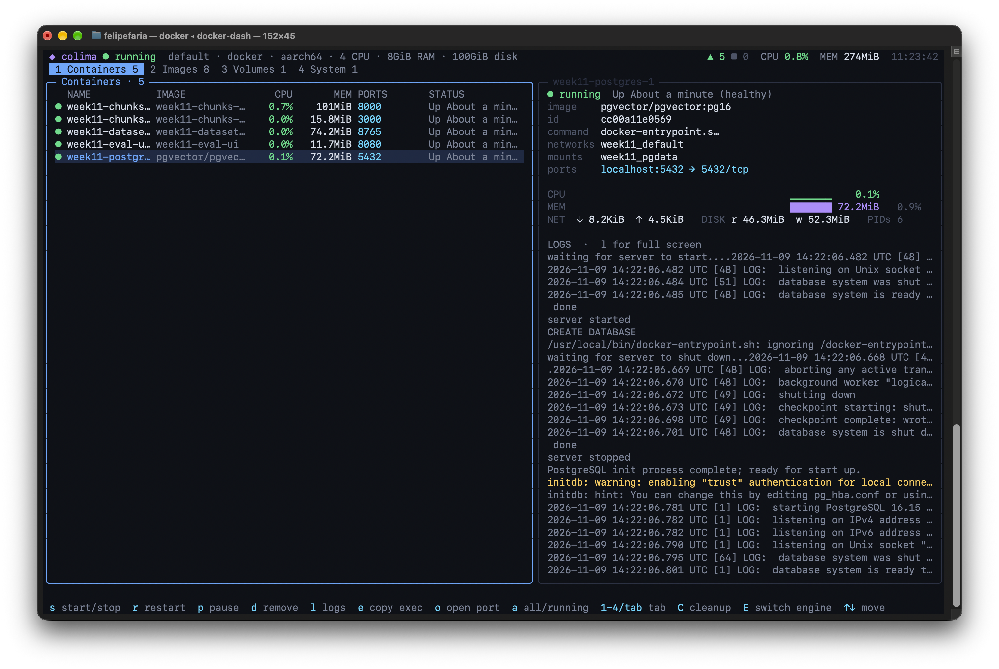
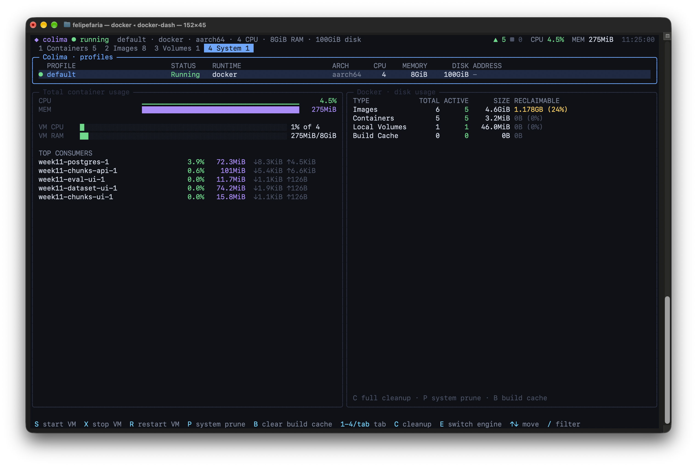

# docker-dash

Terminal dashboard for **Docker (via Colima)** and **Podman (via podman machine)**, built with
[Gridland](https://github.com/thoughtfulllc/gridland). It shows containers, live stats, logs, images,
volumes and disk usage, runs everyday commands with a single key, and does a full cleanup to free up space.





## Installation

You need at least one of the engines installed: `brew install colima docker` or `brew install podman`. Then run:

```bash
./install.sh          # or double-click install.command in Finder
```

The installer:
1. installs [Bun](https://bun.sh) if it isn't there yet (it's only used to compile);
2. compiles a **single binary** that runs without Bun or Node;
3. copies the binary to `~/.local/bin/docker-dash` and adds that folder to the PATH in `~/.zshrc`.

Then open a new terminal and type:

```bash
docker-dash            # opens with the last chosen engine; the first time, shows the engine picker
docker-dash --docker   # straight into Docker + Colima
docker-dash --podman   # straight into Podman
docker-dash --mock     # mock data (combine with --docker/--podman)
docker-dash --help
```

The last choice is saved in `~/.config/docker-dash/config.json` and used directly next time (without asking).
To pin an engine, use `export DOCKER_DASH_ENGINE=podman`. Inside the app, `E` goes back to the engine picker.

To update after changing the code, run `./install.sh` again. To remove it, use `./uninstall.sh`.
To install somewhere else: `PREFIX=/usr/local ./install.sh` (the binary goes to `/usr/local/bin`).

## Development

```bash
bun install
bun start            # runs straight from source
bun run mock         # mock data
bun run compile      # only builds build/docker-dash, without installing
```

## Features

**1 · Containers**: list with state, CPU, memory, ports and status. Next to it are the details of the selected
container: command, networks, mounts, ports, CPU and memory, network and disk sparklines, plus the latest log lines.

| key | action |
|---|---|
| `s` | start / stop |
| `r` | restart |
| `p` | pause / unpause |
| `d` | remove (asks for confirmation; forces it if running) |
| `l` | full-screen logs (↑↓ pgup/pgdn scroll, `f` resumes following) |
| `e` | copies `docker exec -it <name> sh` to the clipboard |
| `o` | opens `http://localhost:<port>` in the browser |
| `a` | toggles between all containers and only running ones |

**2 · Images**: size, age and how many containers use each image. `n` pulls, `d` removes and `P` cleans up `<none>` images.

**3 · Volumes**: shows which containers use each volume. `d` removes, `P` removes unused ones.

**4 · System**: Colima profiles or Podman machines (CPU, RAM, disk, runtime), total machine CPU and RAM usage, top
consumers and `docker system df`. `S` start, `X` stop, `R` restart the machine, `P` system prune, `B` clears the build cache.

**Cleanup (`C`)**: opens a panel with everything that can be deleted and an estimate of the space for each item:

| item | command | default |
|---|---|---|
| Stopped containers | `container prune` | ✓ |
| `<none>` images | `image prune` | ✓ |
| Images with no containers | `image prune -a` | |
| Unused networks | `network prune` | ✓ |
| Build cache (Docker only) | `builder prune -a` | ✓ |
| Volumes with no container (**deletes data**) | `volume prune -a` | |

`space` checks or unchecks, `a` checks everything that's safe and `enter` runs the steps in sequence. At the end,
the panel shows how much space was actually freed, comparing `system df` before and after.

**General**: `1`–`4`/`tab` switch tabs, `C` opens cleanup, `E` switches engine, `/` filters, `u` refreshes, `?` opens help and `q` quits.

Destructive actions (remove, prune, stopping Colima) always ask for confirmation.

## How it works

```
src/
├── cli.tsx              entry point (terminal): flags, config, picks the backend
├── Root.tsx             engine picker → dashboard
├── DockerDash.tsx       UI: tabs, tables, details, modals, cleanup, keyboard
├── useDashData.ts       polling: containers 2s, stats 2.5s, colima 5s, images/volumes/disk 15s
├── backend/
│   ├── types.ts         Backend interface
│   ├── exec.ts          execFile, JSON parsing, engine detection
│   ├── docker.ts        `docker ... --format '{{json .}}'` + `colima list --json`
│   ├── podman.ts        `podman ... --format json` + `podman machine list` (converts Podman's JSON)
│   └── mock.ts          fake backend
└── lib/format.ts        bytes, ports, sparklines, tables
```

Commands are run with `execFile` and the arguments go in an array, with no shell. Docker uses the active
context; with Colima running, it already points to Colima's socket.

`bun run preview` opens the same UI in the browser, with mock data.
